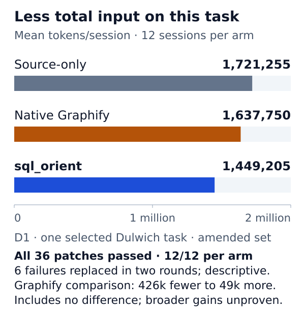
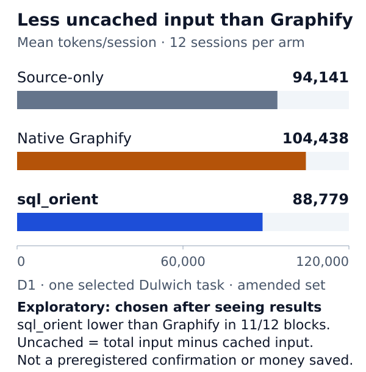

# sql_orient

**Query extracted code relationships with read-only SQL. Give developers and coding agents explicit, bounded context.**

sql_orient imports a [Graphify](https://github.com/Graphify-Labs/graphify) code graph into SQLite, so you can ask precise questions about callers, callees, imports and cross-file connections. SQL decides which stored relationships and columns come back; optional JSON caps make the size of each answer visible and controllable. Every row keeps the producer's source file and line, so answers point back to code that still needs checking.

Early-stage project, version 0.2.0. It is not released on PyPI; install it from a source checkout.

[Why SQL](#why-explicit-sql) · [Quickstart](#quickstart-with-the-synthetic-fixture) · [Example](#example-direction-filters-joins-and-provenance) · [Your own export](#using-your-own-graphify-export) · [Evidence](#evidence-one-task-three-arms) · [Limitations](#limitations-of-imported-facts) · [Docs](#documentation)

## Why explicit SQL

Graphify extracts code relationships and offers its own native tools; for example, `graphify query` answers a plain-language question with a scoped subgraph, and `graphify path` traces how two things connect. Those tools choose what to show. sql_orient starts from the **same exported facts** but lets the consumer choose:

- **Direction**: incoming callers, outgoing calls, or both.
- **Predicates**: relation type, file, label or node identity.
- **Joins**: from edges to the nodes at either end, across files, or to optional SCIP symbols.
- **Columns and order**: return only what the next step needs, in a stable order.
- **Delivery size**: bounded JSON reports how many rows were withheld instead of silently truncating.

The CLI and Python APIs only run read-only SQL. Writes, `ATTACH`, transactions and extension loading are rejected by an SQLite authorizer. sql_orient does not extract, repair or verify the graph.

## What you can query

| Table | Contents |
|---|---|
| `g_nodes` | Graphify nodes: `id`, `label`, `file_type`, `source_file`, `source_location`, `community`, extra fields as JSON |
| `g_edges` | Graphify relationships: `source`, `target`, `relation`, `context`, `source_file`, `source_location`, in input order with duplicates kept |
| `meta` | Build provenance: input paths and hashes, producer versions, observed Git revision, import counts |
| `s_documents`, `s_occurrences`, `s_symbols`, `links` | Optional SCIP documents, occurrences, symbols and exact identity links |

See the [schema guide](docs/schema.md) for column meanings and the [SQL guide](docs/sql.md) for the query interface.

## Install from a source checkout

Python 3.10 or later with SQLite is required. Clone or download the source repository, then from its root:

```sh
python -m venv .venv
. .venv/bin/activate
python -m pip install .
```

`sql-orient` and `python -m sql_orient` are equivalent. There are no runtime dependencies.

## Quickstart with the synthetic fixture

The quickstart inputs, `tests/fixtures/mini/` and `examples/`, are part of the source repository and source distribution. They are not installed with the wheel, and they need neither Graphify nor a SCIP decoder. From the checkout root:

```sh
sql-orient build --repo tests/fixtures/mini/repo --graph tests/fixtures/mini/graph.json --db mini.db
sql-orient sql --db mini.db --file examples/callers.sql
```

Expected TSV output:

```text
caller	relation	target
beta()	calls	alpha()
beta()	calls	alpha()
```

The build imports 15 nodes and 7 relationships, prints JSON diagnostics and refuses to overwrite an existing database. The fixture deliberately stores [one source call](tests/fixtures/mini/repo/mod_b.py) twice: these are duplicate stored facts, not two execution paths.

## Example: direction, filters, joins and provenance

[`examples/relationships.sql`](examples/relationships.sql) returns every call relationship touching `alpha()`, labels each one as incoming or outgoing, and keeps where the producer found it:

```sql
SELECT CASE WHEN e.target = 'mod_a_alpha' THEN 'incoming' ELSE 'outgoing' END AS direction,
       s.label AS source, e.relation, t.label AS target,
       e.source_file, e.source_location
FROM g_edges e
JOIN g_nodes s ON s.id = e.source
JOIN g_nodes t ON t.id = e.target
WHERE 'mod_a_alpha' IN (e.source, e.target)
  AND e.relation = 'calls'
ORDER BY direction, e.id;
```

```sh
sql-orient sql --db mini.db --file examples/relationships.sql
```

| direction | source | relation | target | source_file | source_location |
|---|---|---|---|---|---|
| incoming | beta() | calls | alpha() | mod_b.py | L6 |
| incoming | beta() | calls | alpha() | mod_b.py | L6 |
| outgoing | alpha() | calls | helper() | mod_a.py | L6 |

Filter on node IDs rather than labels when labels can repeat (two different methods are both labelled `.m()` in the fixture), and use a stable `ORDER BY` before any `LIMIT`.

### Bounded JSON for agents

```sh
sql-orient sql --db mini.db --file examples/relationships.sql --format json --max-rows 2
```

This emits two rows and reports `"more_rows": true` with `"limit_reason": "max_rows"`. Caps bound delivered rows and UTF-8 bytes, not query execution cost, and an exhausted result is not proof of source completeness. See the [SQL guide](docs/sql.md) for the full delivery contract.

## Using your own Graphify export

Graphify is an independent project and is not bundled with sql_orient. Its [README](https://github.com/Graphify-Labs/graphify#readme) describes the setup:

1. In a terminal, install the `graphifyy` package, for example `uv tool install graphifyy` (or `pipx install graphifyy`).
2. In a terminal, run `graphify install` once to register Graphify with your AI coding assistant.
3. In the assistant (not the shell), type `/graphify .` to map the current project (Codex uses `$graphify`). Graphify writes `graphify-out/graph.json`.

Graphify's command-line help also documents a headless, code-only extraction that needs no assistant or API key: `graphify extract path/to/source --code-only` writes `path/to/source/graphify-out/graph.json`. Follow upstream for platform-specific steps and current options.

Then point sql_orient at the same source snapshot:

```sh
sql-orient build --repo path/to/source --graph path/to/source/graphify-out/graph.json --db project.db
sql-orient sql --db project.db --query 'SELECT relation, COUNT(*) AS n FROM g_edges GROUP BY relation ORDER BY n DESC'
```

Graphify's clustered export stores relationships under `links`; its raw `--no-cluster` export stores them under `edges`. sql_orient imports either, and rejects a file whose `links` and `edges` differ. Raw exports carry no Graphify version, so `meta` records it as empty. Both shapes were tested with exports from Graphify 0.9.86 and 0.9.91 of a small synthetic project; the study below used 0.9.86. Other versions, and export shapes not described here, are untested.

The database is a snapshot: nothing watches the source tree, so rebuild to a fresh path after changes. Malformed inputs fail with a one-line error and leave no database. Imported metadata records absolute input paths; treat databases as potentially sensitive before sharing. An optional `--scip` index adds symbol identities and occurrence sites; see the [SCIP guide](docs/scip.md).

## Evidence: one task, three arms

One selected Dulwich bug-fix task was run in 12 blocks. Each block had one session per arm: **source-only** (ordinary source and search tools, no index), **Native Graphify** (Graphify's own query tools) and **sql_orient** (called CodeSQL in the study). The two indexed arms were instructed to retrieve at least one relevant relationship before editing. All 36 amended-set patches passed the frozen acceptance checks.





| Metric | Source-only | Native Graphify | sql_orient |
|---|---:|---:|---:|
| Total input | 1,721,255 | 1,637,750 | 1,449,205 |
| Uncached input | 94,141 | 104,438 | 88,779 |

**What the numbers say.** sql_orient's mean total input was 11.5% lower than Native Graphify's and 15.8% lower than source-only. The source-only comparison is secondary, because that arm also lacked the instruction to consult an index. For each block, subtracting Native Graphify's total input from sql_orient's gives a mean paired difference of -188,545 tokens per session. The nominal 95% t-interval for that mean within-block paired difference, with 11 degrees of freedom, runs from -426,147 to +49,057. It includes zero, so the data are also compatible with sql_orient using more total input than Native Graphify.

**Counterexamples and exploratory metrics.** Uncached input (total input minus cached input) was chosen for comparison after the results were seen, so it is exploratory. Native Graphify used more uncached input than source-only (104,438 versus 94,141), so having an index did not by itself reduce uncached input. sql_orient's uncached mean was 15.0% below Native Graphify's but only 5.7% below source-only.

**How the set was formed.** Thirty of the 36 preregistered sessions completed. Six that failed for environment reasons were each replaced once under a post-hoc, owner-authorized amendment, in two rounds. Round 1 replaced four (three quota failures and one provider-capacity failure). Two further sessions, one in the sql_orient arm and one in the Native Graphify arm, had first been retained as agent watchdog timeouts; after their captures showed network loss they were reclassified and replaced in round 2. The preregistered comparison remains unidentified, so these are descriptive amended-set results.

**What is not established.** This is one task with one model and agent harness. Graph build and import costs were not counted. No general efficiency advantage, causal explanation or monetary saving is established, and token counts are not costs.

The figures and table are generated from the sanitized aggregate file [`evidence/d1.json`](evidence/d1.json) by a standard-library renderer: `python scripts/render_evidence.py --check` reproduces the displayed calculations and figures, not the underlying agent experiments. No raw sessions, patches or studied source are included. Details: [evidence guide](docs/evidence.md).

## Limitations of imported facts

- **Facts are only as good as the producer.** Graphify relationships may be coarse, inferred, missing or wrong; sql_orient stores them as given.
- **Absence is not evidence.** Missing rows do not prove that a relationship is absent from the source, and a complete SQL result is not a complete answer.
- **Hyperedges are counted, not imported.** They are reported in build diagnostics and `meta`.
- **SCIP links are identity links.** They do not validate Graphify edges, and SCIP references are not verified calls.
- **Snapshots go stale.** Supplied revisions and observed Git heads are recorded, not certified; verify alignment with the source yourself.
- **The SQL guard is not a sandbox.** It blocks side-effecting statements but does not bound query execution time or memory for untrusted queries.

## Documentation

| Guide | Covers |
|---|---|
| [SQL guide](docs/sql.md) | CLI and Python APIs, bounded JSON delivery, read-only enforcement and its boundary |
| [Schema guide](docs/schema.md) | Tables, metadata keys, schema version and historical compatibility |
| [SCIP guide](docs/scip.md) | Optional SCIP JSON and binary input, coordinates and identity links |
| [Evidence guide](docs/evidence.md) | Data provenance, replacement chronology, interval definition and reproduction |
| [Examples](examples/) | Runnable queries over the synthetic fixture |
| [Contributing](CONTRIBUTING.md) | Development checks matching CI |

## License and contributions

Copyright 2026 keremnv. sql_orient project material is licensed under Apache-2.0; see [LICENSE](LICENSE) and [NOTICE](NOTICE). External projects, including Graphify and SCIP, are owned by their respective authors and retain their own licenses; see [ATTRIBUTION.md](ATTRIBUTION.md). No affiliation with or endorsement by Graphify is implied. Contribution guidance is in [CONTRIBUTING.md](CONTRIBUTING.md).
